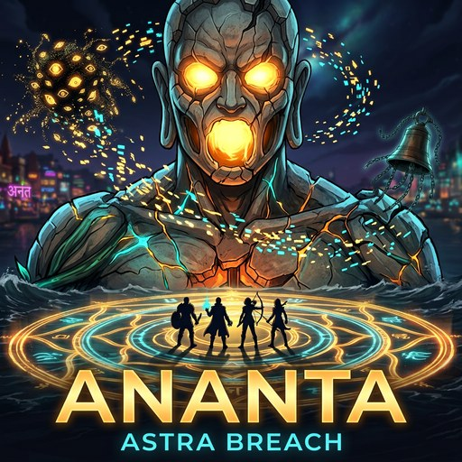
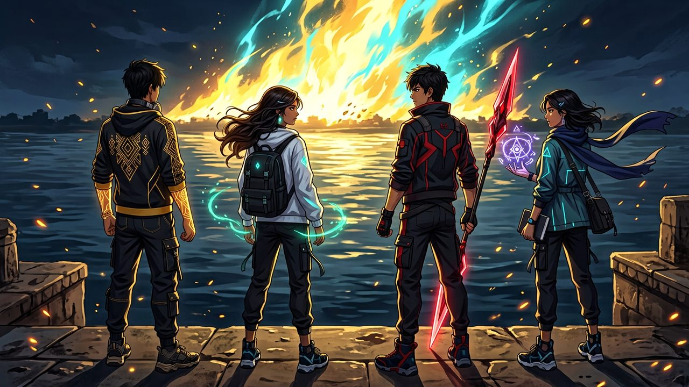
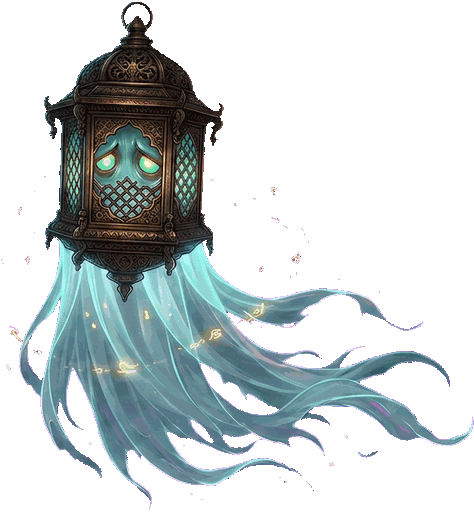
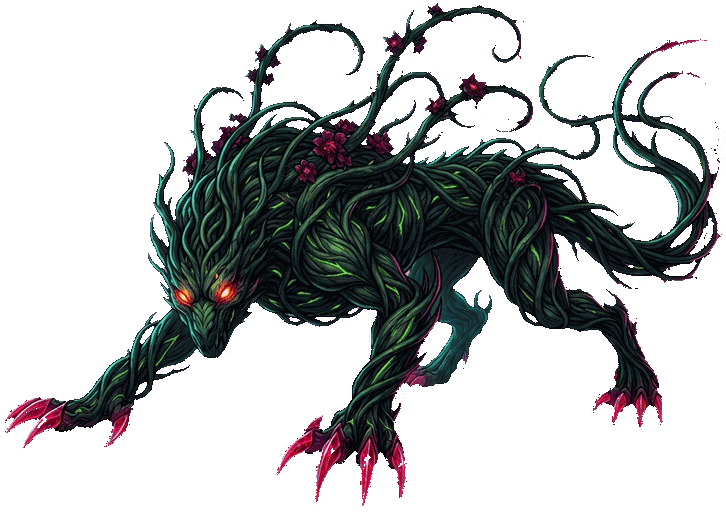
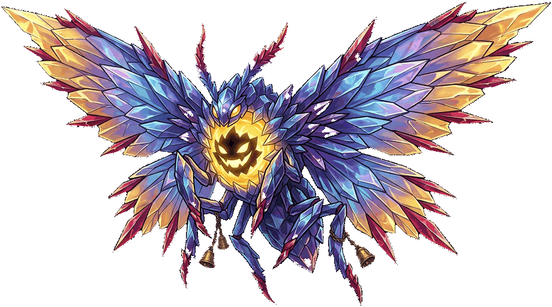
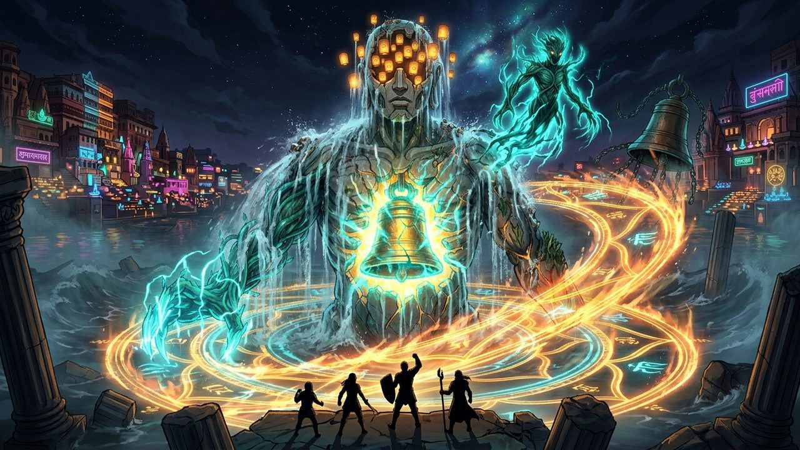

# ANANTA: Astra Breach



Neo-Varanasi, 2042. The Astra Grid has shattered, and hybrid creatures wander the ghats. Do not kill them. Switch between Rudra, Aadhya, Ira, and Ronit, and restore them. Voiced intro, cinematic story, and a boss that mirrors how you play. English and Hinglish.

**Play:** [w.run/rudra/ananta-astra-breach](https://w.run/rudra/ananta-astra-breach)

October Jam 2026. Monster Mash.

## The night city


A future night on an old river. Broken patterns walk the steps. The work is not to hunt them. The work is to bring them back.



## Four heroes

| Rudra | Aadhya | Ronit | Ira |
| --- | --- | --- | --- |
|  |  |  |  |
| **1 · Astra Fist** | **2 · Restore** | **3 · Vel** | **4 · Scan** |
| Breaks what is unstable. The wrong strike makes claws multiply. | Fixes what broke. Restore turns claws back into leaves. | A thrown strike for the copy, and for bells too far to touch. | Finds what is hidden, and reads the pattern before anyone else moves. |

   

## What walks the ghats

  

Do not kill them. Each one has a counter. The wrong hero makes the mash worse.

## The drowned guardian



Read. Counter. Break. The boss at the end mirrors how you played.

## Controls

- Move: WASD or arrow keys. On a phone, the stick.
- Switch hero: `1` `2` `3` `4`, or tap the portraits.
- Ability: `Space` or `E`. On a phone, the Astra button.
- Skip the intro: Skip, or Esc.

## Run it locally

```bash
npm install
npm run dev
